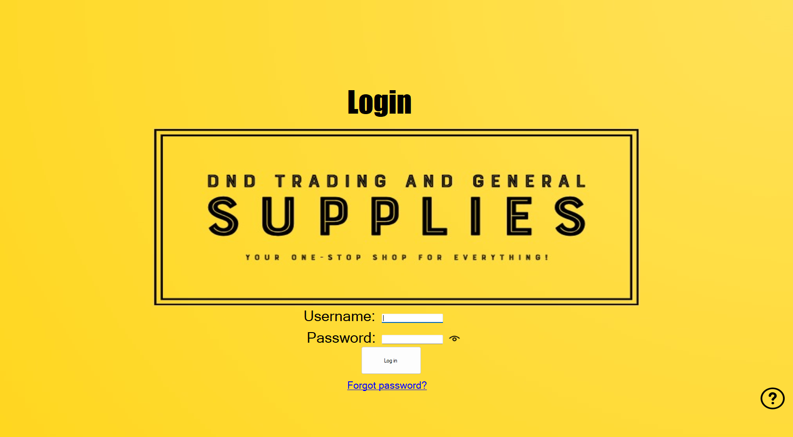

# DnD Trading

Sales and order management desktop application developed for **DnD Trading & General Supplies**, a stationery supplier. The system brings client records, supplier products, order requests, payments and reporting into a Windows Forms interface.

Developed as an **ISTN3AS Group 22** project by **Horizon Innovations**.

## Application preview

Preserved login-screen capture from the original desktop application.

The original SQL Server database is no longer available. This repository preserves the application source and its existing preview; database-backed workflows require a separately supplied compatible database.

## Features

| Area | Functionality |
| --- | --- |
| Clients | Add and search client records; update contact details and opt-out status. |
| Products and suppliers | Maintain product and supplier records, supplier pricing and product surcharges. |
| Orders | Capture client order requests, select supplier products and quantities, and calculate order totals. |
| Payments | Record payments, track amounts due and filter by payment status. |
| Users | Sign in as a sales representative or manager, with role-based menu access. |
| Reports | View reports through SAP Crystal Reports. |
| Email | Send a client payment request when SMTP credentials are configured. |

## Technology

- C# and Windows Forms
- .NET Framework 4.7.2
- SQL Server with an ADO.NET typed DataSet and TableAdapters
- SAP Crystal Reports for Visual Studio

## Repository layout

| Path | Contents |
| --- | --- |
| `DnD Trading.sln` | Visual Studio solution. |
| `src/DnD.Trading/` | Application project, forms, resources and report definitions. |
| `src/DnD.Trading/Properties/` | Application settings and embedded image resources. |
| `src/DnD.Trading/WstGrp22DataSet.xsd` | DataSet schema, mappings and adapter queries. |
| `docs/SETUP.md` | Development setup, configuration and troubleshooting. |
| `docs/images/login.png` | Preserved application login-screen capture. |

The WinForms designer files, typed DataSet code and Crystal Reports definitions are retained because the project uses them. Visual Studio caches, personal settings and compiled output are excluded.

## Building the source

1. On Windows, install Visual Studio with the **.NET desktop development** workload, the **.NET Framework 4.7.2 Developer Pack**, and the compatible **SAP Crystal Reports for Visual Studio** tools and runtime.
2. Copy `src/DnD.Trading/ConnectionStrings.example.config` to `src/DnD.Trading/ConnectionStrings.config` and enter your database settings.
3. Open `DnD Trading.sln` and build the solution.

See the [setup guide](docs/SETUP.md) for detailed steps, official downloads and email configuration.

**A compatible SQL Server database is required for database-backed functionality.** This repository includes the DataSet and adapter queries, but does not include a database backup, database creation script or seeded demo account.

## Configuration

Database connection strings are read from the local, ignored `ConnectionStrings.config` file. SMTP credentials are read from the `DND_SMTP_USER` and `DND_SMTP_PASSWORD` environment variables. When email is not configured, the order is saved and the application explains that the payment request was not sent.

## Team

Horizon Innovations:

- Darian Robert
- Arjun Ramphal
- Lokadi Naicker
- Keolin Naicker
- Zaheera Ganie
